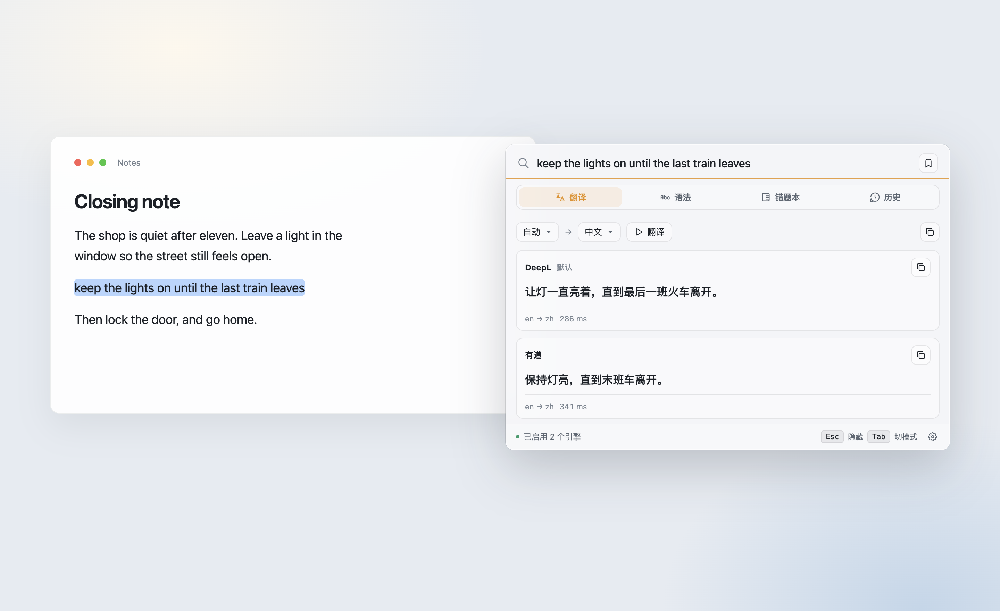

# Jiti

<p align="center">
  
</p>

<p align="center">
  <a href="https://k1nz.github.io/jiti/">Website</a>
  ·
  <a href="https://github.com/k1nz/jiti/releases">Releases</a>
  ·
  <a href="#中文">中文</a>
  ·
  <a href="#english">English</a>
</p>

选中一段文字，按一下全局快捷键。译文或语法结果出现在浮层里，你正在用的窗口还在前面。

Select some text and press a global shortcut. The translation or grammar result shows up in an overlay, and the window you were using stays in front.

## 中文

Jiti 是常驻后台的系统浮层，面向 macOS 与 Windows 10/11。它在本地运行，用你自己的翻译或模型 Key，不需要账号。

### 能做什么

- **翻译。** 中英自动判向，也可以自己输入。已启用的引擎会并行返回，目前包括 DeepL、有道、Google、Bing，以及 OpenAI 兼容的大模型。
- **语法。** 检查英语句子，给出改写，并逐条说明问题。
- **错题本。** 语法错误会自动归档。可以按类型和时间筛选，导出 Markdown，也可以在独立的复习课窗口里做填空和默写。
- **收藏与历史。** 热键可以静默收藏当前选中的短语。最近的查询留在历史里。

macOS 上，面板走原生的无焦点路径显示。设置里也可以改成唤起时聚焦输入框。读取其他 App 里的选中文字需要辅助功能权限；不开启时，仍然可以手动输入。

### 默认快捷键

| | macOS | Windows |
| --- | --- | --- |
| 翻译 | `⌥⌘T` | `Ctrl+Shift+T` |
| 语法 | `⌥⌘G` | `Ctrl+Alt+G` |
| 统一面板 | `⌥⌘Space` | `Ctrl+Alt+Space` |
| 收藏选中 | `⌥⌘S` | `Ctrl+Alt+S` |

面板里 `Esc` 隐藏，`Tab` 切换模式。快捷键可以在设置里重配：面板内 `⌘,` / `Ctrl+,`，或从托盘打开「设置」。托盘还有「显示面板」和「退出」。

### 下载

当前发布的是预览版。安装包在 [Releases](https://github.com/k1nz/jiti/releases)，介绍页在 [k1nz.github.io/jiti](https://k1nz.github.io/jiti/)。

### 从源码运行

技术栈是 Tauri 2（Rust）和 Vue 3。界面在 `packages/ui`，原生层在 `packages/native`。架构见 [docs/architecture.md](docs/architecture.md)，IPC 契约见 [docs/api-contract.md](docs/api-contract.md)。

```bash
pnpm install
pnpm dev          # 启动 Vite，编译并打开 App
pnpm test         # vitest + cargo test
pnpm build        # 生产构建
pnpm build:mac    # macOS：用本地证书签名后安装到 /Applications
```

`pnpm build:mac` 会把「辅助功能」授权锚在自签名证书 `Jiti Local Dev` 上，重装或升级后授权还在。证书材料见 [docs/macos-signing.md](docs/macos-signing.md)。

## English

Jiti is a system overlay for macOS and Windows 10/11. It stays in the background, runs locally, and uses your own translation or model key. There is no account.

### What it does

- **Translate.** Chinese and English, with the direction detected automatically. You can also type. Enabled engines answer in parallel: DeepL, Youdao, Google, Bing, and an OpenAI-compatible model.
- **Grammar.** Check an English sentence, get a rewrite, and read a note for each issue.
- **Notebook.** Grammar misses are filed automatically. Filter them, export Markdown, and practice fill-in or dictation in a separate study window.
- **Clips and history.** A shortcut saves the current selection without opening the panel. Recent queries stay in history.

On macOS the panel uses a native no-activate path, so the window you were typing in stays in front. Settings can focus the input on invoke instead. Reading a selection in another app needs Accessibility permission. You can also type into the panel directly.

### Default shortcuts

| | macOS | Windows |
| --- | --- | --- |
| Translate | `⌥⌘T` | `Ctrl+Shift+T` |
| Grammar | `⌥⌘G` | `Ctrl+Alt+G` |
| Panel | `⌥⌘Space` | `Ctrl+Alt+Space` |
| Save selection | `⌥⌘S` | `Ctrl+Alt+S` |

`Esc` hides the panel. `Tab` switches mode. Remap shortcuts in Settings (`⌘,` / `Ctrl+,` from the panel, or Settings from the tray). The tray also shows the panel and quits the app.

### Download

The current build is a preview. Installers are on [Releases](https://github.com/k1nz/jiti/releases). The site is [k1nz.github.io/jiti](https://k1nz.github.io/jiti/).

### Run from source

The stack is Tauri 2 (Rust) and Vue 3. The UI lives in `packages/ui`, the native layer in `packages/native`. Architecture: [docs/architecture.md](docs/architecture.md). IPC contract: [docs/api-contract.md](docs/api-contract.md).

```bash
pnpm install
pnpm dev          # Vite, compile, and launch the app
pnpm test         # vitest + cargo test
pnpm build        # production build
pnpm build:mac    # macOS: sign with the local cert, then install to /Applications
```

`pnpm build:mac` anchors the Accessibility grant to the self-signed `Jiti Local Dev` certificate, so reinstalls and upgrades keep the permission. Certificate notes: [docs/macos-signing.md](docs/macos-signing.md).
